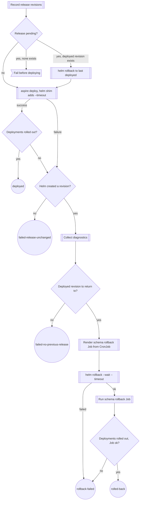

# Deployments

Audience: release manager + platform maintainer.

A deployment must not be able to leave an environment broken ([ADR-0010](adr/0010-deploy-rollback-guard.md)).
A failed deployment restores the last good release and still fails the job.

## Model

Build once. Deploy by digest.

```text
source -> build artifact/image digest -> attest/manifest -> environment approval -> deploy -> verify or roll back -> report
```

## Kubernetes rules

- Use image digest, not mutable tag.
- Render manifests before apply.
- Upload rendered manifests.
- Bound every Helm wait with an explicit `--timeout`.
- Roll back a failed release; do not leave it failed and half-rolled.
- Verify rollout status after Helm reports success. `--wait` alone is not the verdict.
- On failure collect events, describe, pod logs, before reverting anything.
- Never read Secret objects or store pod environment values in diagnostics.
- Namespace explicit.
- Context explicit.
- Verification workflow supported without environment approval or cluster mutation.

## Rollback

Last verified: 2026-11-19 against the Helm 4 `upgrade`, `rollback`, `history`, `status`, and `list` references, and live against a kind cluster (Kubernetes v1.37.0, Helm v4.3.1) with `tests/live/helm-release-guard-kind.sh`.

`wf-deploy-k8s-aspire.yml` does not use Helm's own `--rollback-on-failure` (Helm 3: `--atomic`).
`aspire deploy` runs `helm upgrade --install <release> <chart> --namespace <ns> --create-namespace --wait` with a closed argument list: no `--timeout`, no rollback, no way to add either.
The workflow therefore does the work around it, in the `helm-release-guard` action.

> Diagram: what the deploy job does before and after `aspire deploy`, and which outcome each path reports.

<details>
<summary>Rollback decision flow</summary>



</details>

| Step | When | What |
|---|---|---|
| Record | before deploy | `helm list` + `helm history`: current revision and the last `deployed` revision, the rollback target. No release means first install. An unreadable release stops the job before anything is deployed. |
| Recover | before deploy | A release in `pending-install`, `pending-upgrade`, or `pending-rollback` (a run was cancelled mid-operation) is rolled back to its last `deployed` revision, so a dead run cannot wedge later deploys. |
| Bound the wait | during deploy | A `helm` shim, first on `PATH` for the deploy step only, appends `--timeout <rollout-timeout>` to `helm upgrade`. Everything else passes through. |
| Verify | deploy succeeded | `kubectl rollout status` for every Deployment the release owns. A Deployment that is not rolled out turns the run into a failed deployment. |
| Diagnose | deploy failed | `helm status` and `helm history`, `kubectl get deployments,replicasets,pods -o wide`, events sorted by time, `describe` of non-ready pods, current and previous logs of every container including init containers. Collected before the rollback. |
| Roll back | deploy failed | `helm rollback <release> <revision> --wait --timeout <rollout-timeout>`. Skipped when Helm never created a revision, on a first install, or when `rollback-on-failure` is `false`. |
| Schema hook | rollback succeeded | Runs the consumer's `schema-rollback` Job. See below. |
| Re-verify | after rollback | `kubectl rollout status` again. |

The job ends **failed** whenever the deployment failed, including when the rollback restored everything.
The step summary, the workflow outputs, and `artifacts/deploy-report/deploy-report.json` in the deploy artifact carry:

- Previous revision and its status.
- New revision (the one this deployment created) and the current live revision.
- Outcome.
- Failed resource names.
- On success, the manual rollback command for the previous revision.

| Outcome | Meaning | Environment |
|---|---|---|
| `deployed` | Helm succeeded and every Deployment is rolled out. | new release |
| `rolled-back` | The deployment failed; release, schema hook, and rollouts are restored. | previous release |
| `rollback-failed` | The Helm rollback failed, the workloads did not become ready after it, the schema hook failed or timed out, or a stuck release could not be recovered. | **needs attention** |
| `failed-no-previous-release` | A first install failed. Nothing exists to return to; the failed release stays for inspection. | **needs attention** |
| `failed-release-unchanged` | The deployment failed before Helm created a revision (build, push, render). | untouched |
| `failed-rollback-disabled` | The deployment failed and `rollback-on-failure` is `false`. | **needs attention** |
| `cancelled` | The run was cancelled or hit the job timeout. No rollback is attempted; the next run recovers a pending release first. | unverified |
| `not-attempted` | An earlier step failed. | untouched |

The `schema-rollback` output separates a failed Helm rollback from a failed schema hook: `succeeded`, `failed`, `timed-out`, `skipped`, `not-found`, `not-configured`, or `not-run`.

### Consumer contract

The rollback only restores an environment whose chart cooperates.

| Requirement | Why |
|---|---|
| Deployments use `strategy.rollingUpdate.maxUnavailable: 0`. | Old pods keep serving while new pods fail, so users see no outage between the failure and the rollback. |
| Every container has a startup or readiness probe that fails when the app cannot work. | `--wait` and the rollout verification only see readiness. A pod that reports ready while broken deploys green. |
| Migrations stay compatible with the previous release. | Old and new pods run side by side during every rollout, and old pods keep running after a failed one. Expand first, contract in a later release. |
| The chart ships a suspended `schema-rollback` CronJob when a release changes the schema in a way the previous release cannot run on, preferably as a Helm `pre-install,pre-upgrade` hook. | Helm reverts manifests, not data. |
| The schema hook is idempotent and depends only on objects the previous release also has. | It may run when the migrator never did, and it runs after the rollback reverted the release's ConfigMaps and Secrets. |
| The schema hook leaves alone every schema change it recorded before `ARKANIS_DEPLOY_STARTED_AT`, and succeeds doing nothing when there is no later one. | A hook-shaped CronJob also runs when a redeploy of an already deployed version fails. Its checkpoint from the earlier, successful deploy must not be reverted under the restored release. |
| The deployment does not pass `--no-hooks` when the CronJob is a Helm hook. | Without hooks the CronJob is never replaced and still describes the previous release. `aspire deploy` does not pass it. |
| The Helm release name is the lowercased `aspire-environment`, or the caller passes `helm-release-name`. | The guard must know the release before deploying to recover it when stuck. A mismatch is detected and still rolled back, with a warning. |
| Deployments set `progressDeadlineSeconds` to the time a rollout may really take. | Helm's wait fails as soon as a Deployment reports `Progress deadline exceeded`, before `rollout-timeout`. The Kubernetes default is 600 seconds, so with the default `15m` a stalled rollout fails after 10 minutes. `rollout-timeout` is the upper bound, not the only one. |
| `timeout-minutes` exceeds twice `rollout-timeout` plus build time. | A job timeout cancels the rollback. The default 60 covers the default `15m`. |

### Schema rollback hook

Convention: a CronJob named `schema-rollback` (input `schema-rollback-cronjob`) with `suspend: true`, in the release's chart, whose pod runs the **new** release's migrator in "undo this release's schema changes" mode.
It never runs on a schedule; it exists so the workflow can instantiate it.
The Job is always created from the CronJob of the release that just failed, never from the previous release's.

Two shapes are supported:

| Shape | How Helm treats it | How the guard sees "this deployment replaced it" |
|---|---|---|
| **Helm hook (recommended)**: `helm.sh/hook: pre-install,pre-upgrade` and `helm.sh/hook-delete-policy: before-hook-creation` | Deleted and recreated before every install and upgrade. Not part of the release manifest. | New `metadata.uid`. The generation is `1` every time. |
| Ordinary chart resource | Patched in place with the other resources. Reverted or deleted by `helm rollback`. | Same uid, higher `metadata.generation`. |

Prefer the hook shape.
Helm applies `pre-upgrade` hooks before any workload of the new release, so the rollback Job for release N exists even when the upgrade dies part-way, and `helm rollback` does not revert a hook.
An ordinary resource is applied together with the workloads: an upgrade that fails early can leave the previous release's CronJob in place, and the guard then skips the hook.

```yaml
apiVersion: batch/v1
kind: CronJob
metadata:
  name: schema-rollback
  annotations:
    helm.sh/hook: pre-install,pre-upgrade
    helm.sh/hook-delete-policy: before-hook-creation
spec:
  suspend: true
  schedule: "0 0 1 1 *"
  jobTemplate:
    spec:
      backoffLimit: 0
      template:
        spec:
          restartPolicy: Never
          containers:
            - name: migrator
              image: ghcr.io/example/migrator@sha256:... # this release's migrator
              args: ["--revert-to-previous-release"]
```

#### `ARKANIS_DEPLOY_STARTED_AT`

Every container and init container of the Job receives `ARKANIS_DEPLOY_STARTED_AT`: the instant this deployment attempt began, as an RFC 3339 UTC timestamp with second precision, for example `2026-11-19T10:15:30Z`.
An entry of the same name in the chart is replaced.

Rule: the hook MUST treat schema changes recorded before that instant as not belonging to this deployment and leave them alone. With nothing recorded at or after it, the hook succeeds without doing anything.

Why it exists: v1.2.3 deploys and its migrator records what it applied. Later the same version is redeployed for a config change and the rollout fails. The hook runs v1.2.3's migrator, which finds its own record from the first, successful deploy. Without the timestamp it would revert that schema under the live, restored v1.2.3.

The value comes from the runner's clock, read before any image build or Helm call, so everything this attempt did happened after it.
A consumer comparing it with database time must not add tolerance in the direction that includes older changes: do not subtract a margin from it.

Order on a failed deployment:

1. Before the Helm rollback, the workflow renders a Job from the failed release's CronJob (`kubectl create job --from=cronjob/schema-rollback --dry-run=client`). For an ordinary chart resource this must happen first because the rollback reverts or deletes that CronJob; for a hook it changes nothing.
2. `helm rollback` runs and waits. After it, no new-version pod uses the schema.
3. The rendered Job is created, without its owner reference, with `ttlSecondsAfterFinished` and `ARKANIS_DEPLOY_STARTED_AT`, and awaited for at most `rollout-timeout`.
4. Its logs go to the deploy artifact. A completed Job is deleted; a failed or still-running Job stays in the cluster.

The hook is skipped, with a log line, when the CronJob does not exist, and when this deployment did not replace it.
"Replaced" means the uid or the generation differs from what was recorded before the deploy, or the CronJob did not exist before.
A CronJob with the same uid and the same generation still belongs to the previous release, and running it would undo the schema being restored.
The guard finds the CronJob by name: Helm does not put `meta.helm.sh/release-name` on hook resources, only on ordinary ones.
A failed or timed-out Job raises an error, sets `schema-rollback` to `failed` or `timed-out`, and makes the outcome `rollback-failed`: workloads are back, the database is not.

### Failure modes

| Symptom | Likely cause | How to confirm | Fix | Prevention |
|---|---|---|---|---|
| `rollback-failed`, "stuck in 'pending-install' ... no deployed revision" | A first install was cancelled mid-way. | `helm history <release> -n <ns>` shows only pending or failed revisions. | Inspect, then `helm uninstall <release> -n <ns>` and redeploy. | Do not cancel a first install. |
| `rollback-failed` after a rollback that "succeeded" | The previous release no longer runs: schema moved on, a dependency changed. | `diagnostics/after-rollback` and pod logs in the deploy artifact. | Fix forward or restore data. | Keep migrations compatible; ship a `schema-rollback` hook. |
| Warning "The AppHost deployed Helm release 'x', not 'y'" | The AppHost sets a release name or namespace. | The warning names both. | Pass `helm-release-name: x`. | Set it when adopting the workflow. |
| Deploy green but pods crash later | Probes report ready before the app works. | Pod restarts after the rollout. | Add a startup probe that reflects real readiness. | Probe contract above. |
| Schema hook `skipped`, "not changed by this deployment" | The CronJob is an ordinary chart resource and its spec is identical to the previous release's, the upgrade failed before applying it, or the deploy ran with `--no-hooks`. | `kubectl get cronjob schema-rollback -o jsonpath='{.metadata.uid}/{.metadata.generation}'` before and after. | Ship it as a `pre-install,pre-upgrade` hook with `before-hook-creation`. | Same. |
| `cancelled`, release left `pending-upgrade` | Job timeout or manual cancel during the Helm wait. | `helm status <release> -n <ns>`. | Rerun; the next run recovers the release before deploying. | Raise `timeout-minutes`. |

Diagnostics can still contain whatever the application writes to its own log.
The guard itself reads no Secret, no release values, and no release manifest, and replaces every literal value in a pod's `Environment` block with `<redacted>`.

## Auth

- Prefer OIDC cloud auth.
- Avoid stored kubeconfig.
- Store temporary kubeconfig under `$RUNNER_TEMP`.
- Delete credentials in cleanup.

The deploy identity needs, in the target namespace: read on Deployments, StatefulSets, DaemonSets, Jobs, ReplicaSets, Pods, pod logs, Events, and CronJobs; create, get, and delete on Jobs; and whatever Helm needs to apply and roll back the chart, including its release Secrets.

## Concurrency

Last verified: 2026-07-04 against GitHub Actions concurrency docs.

Concurrency group per app/env:

```yaml
concurrency:
  group: deploy-${{ inputs.app }}-${{ inputs.environment }}
  cancel-in-progress: false
  queue: max
```

Use environment protection for prod.
Current platform workflows omit `queue: max` until the pinned actionlint version supports the key.
