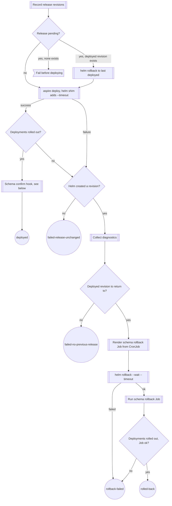
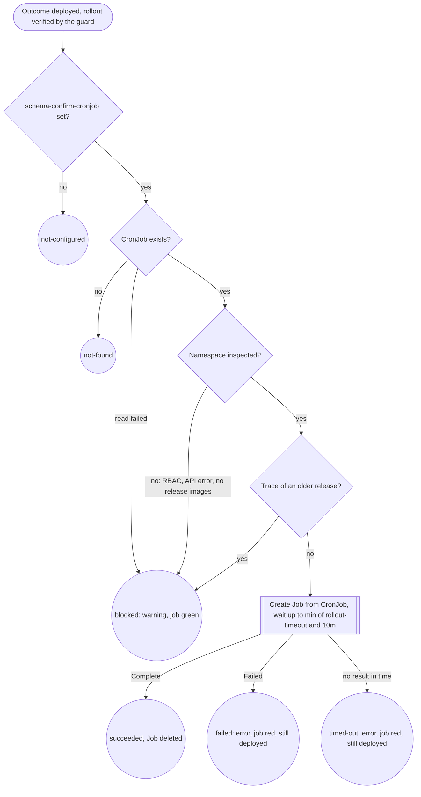
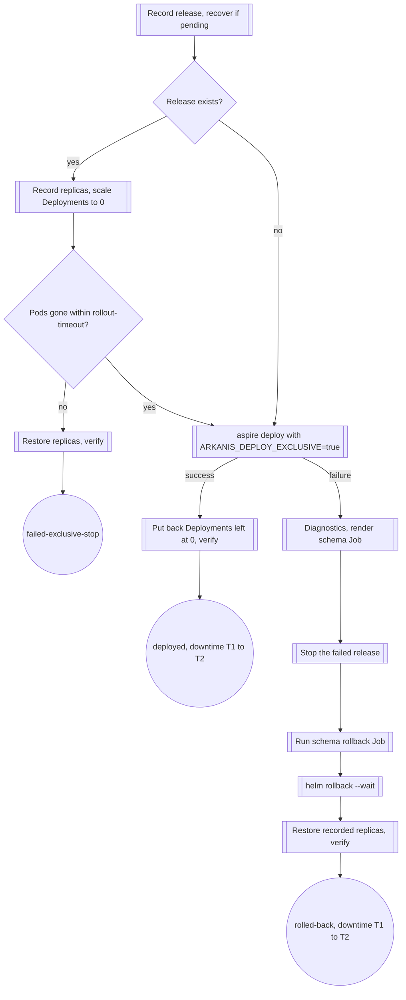

# Deployments

Audience: release manager + platform maintainer.

A deployment must not be able to leave an environment broken ([ADR-0010](adr/0010-deploy-rollback-guard.md)).
A failed deployment restores the last good release and still fails the job.

## Model

Build once. Deploy by digest.

```text
source -> build artifact/image digest -> attest/manifest -> environment approval -> deploy -> verify or roll back -> report
```

## Kubernetes rules

- Use image digest, not mutable tag.
- Render manifests before apply.
- Upload rendered manifests.
- Bound every Helm wait with an explicit `--timeout`.
- Roll back a failed release; do not leave it failed and half-rolled.
- Verify rollout status after Helm reports success. `--wait` alone is not the verdict.
- On failure collect events, describe, pod logs, before reverting anything.
- Never read Secret objects or store pod environment values in diagnostics.
- Namespace explicit.
- Context explicit.
- Verification workflow supported without environment approval or cluster mutation.

## Rollback

Last verified: 2026-11-19 against the Helm 4 `upgrade`, `rollback`, `history`, `status`, and `list` references, and live against a kind cluster (Kubernetes v1.37.0, Helm v4.3.1) with `tests/live/helm-release-guard-kind.sh`.

`wf-deploy-k8s-aspire.yml` does not use Helm's own `--rollback-on-failure` (Helm 3: `--atomic`).
`aspire deploy` runs `helm upgrade --install <release> <chart> --namespace <ns> --create-namespace --wait` with a closed argument list: no `--timeout`, no rollback, no way to add either.
The workflow therefore does the work around it, in the `helm-release-guard` action.

> Diagram: what the deploy job does before and after `aspire deploy`, and which outcome each path reports.

<details>
<summary>Rollback decision flow</summary>



</details>

| Step | When | What |
|---|---|---|
| Record | before deploy | `helm list` + `helm history`: current revision and the last `deployed` revision, the rollback target. No release means first install. An unreadable release stops the job before anything is deployed. |
| Recover | before deploy | A release in `pending-install`, `pending-upgrade`, or `pending-rollback` (a run was cancelled mid-operation) is rolled back to its last `deployed` revision, so a dead run cannot wedge later deploys. |
| Bound the wait | during deploy | A `helm` shim, first on `PATH` for the deploy step only, appends `--timeout <rollout-timeout>` to `helm upgrade`. Everything else passes through. |
| Chart wins over manual edits | during deploy and rollback | The shim appends `--force-conflicts` to `helm upgrade`, and the guard to `helm rollback`, when the release is applied server-side (`helm get metadata` reports `applyMethod: ssa`). A field changed by hand on the cluster (`kubectl edit`, `kubectl patch`) is overwritten by the chart instead of failing the deployment with `conflict occurred while applying object`. Client-side releases and first installs are left alone: Helm rejects the flag there. |
| Verify | deploy succeeded | `kubectl rollout status` for every Deployment the release owns. A Deployment that is not rolled out turns the run into a failed deployment. |
| Diagnose | deploy failed | `helm status` and `helm history`, `kubectl get deployments,replicasets,pods -o wide`, events sorted by time, `describe` of non-ready pods, current and previous logs of every container including init containers. Collected before the rollback. |
| Roll back | deploy failed | `helm rollback <release> <revision> --wait --timeout <rollout-timeout>`. Skipped when Helm never created a revision, on a first install, or when `rollback-on-failure` is `false`. |
| Schema hook | rollback succeeded | Runs the consumer's `schema-rollback` Job. See below. |
| Re-verify | after rollback | `kubectl rollout status` again. |
| Schema confirm | rollout verified | Runs the consumer's `schema-confirm` Job when nothing of an older release is left. See [Schema confirm hook](#schema-confirm-hook). |

The job ends **failed** whenever the deployment failed, including when the rollback restored everything.
The step summary, the workflow outputs, and `artifacts/deploy-report/deploy-report.json` in the deploy artifact carry:

- Why it failed: Helm's own error for the failed revision, in full (`failure_reason` in the JSON). When Helm succeeded but a rollout did not, the Deployments that did not roll out.
- Revision before this deployment, the revision this deployment created, and the revision live now. After a rollback the live row reads `9 (rolled back from 8 to 7: same content as revision 7)`, because Helm records a rollback as a new revision.
- Outcome.
- Failed resource names.
- On success, the manual rollback command for the previous revision.

| Outcome | Meaning | Environment |
|---|---|---|
| `deployed` | Helm succeeded and every Deployment is rolled out. If the guard could not check the rollout itself, the outcome stays `deployed` on Helm's own wait, `rollout_verified` in the report is `false`, and the summary says why. | new release |
| `rolled-back` | The deployment failed; release, schema hook, and rollouts are restored. | previous release |
| `rollback-failed` | The Helm rollback failed, the workloads did not become ready after it, the schema hook failed or timed out, or a release already stuck in a pending state could not be recovered before the deploy (headline `DEPLOYMENT NOT STARTED`). | **needs attention** |
| `failed-no-previous-release` | A first install failed. Nothing exists to return to; the failed release stays for inspection. | **needs attention** |
| `failed-release-unchanged` | The deployment failed before Helm created a revision (build, push, render). | untouched |
| `failed-rollback-disabled` | The deployment failed and `rollback-on-failure` is `false`. | **needs attention** |
| `failed-exclusive-stop` | `exclusive: true`, and the release could not be stopped before the deploy. Nothing was deployed; the recorded replica counts are restored and rolled out. When that restore fails too, the outcome is `rollback-failed`. | previous release |
| `cancelled` | The run was cancelled or hit the job timeout. No rollback is attempted; the next run recovers a pending release first. | unverified |
| `not-attempted` | An earlier step failed, or the release could not be read before the deploy (cluster or Helm unreachable). The summary repeats Helm's error. | untouched |

The `schema-rollback` output separates a failed Helm rollback from a failed schema hook: `succeeded`, `failed`, `timed-out`, `skipped`, `not-found`, `not-configured`, or `not-run`.
The `schema-confirm` output reports the [schema confirm hook](#schema-confirm-hook). A failed or timed-out confirm is the one case where the job fails while the outcome is `deployed`.

### Consumer contract

The rollback only restores an environment whose chart cooperates.

| Requirement | Why |
|---|---|
| Deployments use `strategy.rollingUpdate.maxUnavailable: 0`. | Old pods keep serving while new pods fail, so users see no outage between the failure and the rollback. |
| Every container has a startup or readiness probe that fails when the app cannot work. | `--wait` and the rollout verification only see readiness. A pod that reports ready while broken deploys green. |
| Migrations stay compatible with the previous release, unless the deployment is [exclusive](#rolling-versus-exclusive). | Old and new pods run side by side during every rollout, and old pods keep running after a failed one. Expand first, contract in a later release. |
| The migrator refuses a migration marked breaking unless `ARKANIS_DEPLOY_EXCLUSIVE` is `true`. | A rolling deploy of a breaking migration breaks the previous version while it still serves. See [Rolling versus exclusive](#rolling-versus-exclusive). |
| The chart ships a suspended `schema-rollback` CronJob when a release changes the schema in a way the previous release cannot run on, preferably as a Helm `pre-install,pre-upgrade` hook. | Helm reverts manifests, not data. |
| The schema hook is idempotent and depends only on objects the previous release also has. | It may run when the migrator never did, and it runs after the rollback reverted the release's ConfigMaps and Secrets. |
| The schema hook leaves alone every schema change it recorded before `ARKANIS_DEPLOY_STARTED_AT`, and succeeds doing nothing when there is no later one. | A hook-shaped CronJob also runs when a redeploy of an already deployed version fails. Its checkpoint from the earlier, successful deploy must not be reverted under the restored release. |
| The deployment does not pass `--no-hooks` when the CronJob is a Helm hook. | Without hooks the CronJob is never replaced and still describes the previous release. `aspire deploy` does not pass it. |
| The Helm release name is the lowercased `aspire-environment`, or the caller passes `helm-release-name`. | The guard must know the release before deploying to recover it when stuck. A mismatch is detected and still rolled back, with a warning. |
| Deployments set `progressDeadlineSeconds` to the time a rollout may really take. | Helm's wait fails as soon as a Deployment reports `Progress deadline exceeded`, before `rollout-timeout`. The Kubernetes default is 600 seconds, so with the default `15m` a stalled rollout fails after 10 minutes. `rollout-timeout` is the upper bound, not the only one. |
| `timeout-minutes` exceeds twice `rollout-timeout` plus build time. | A job timeout cancels the rollback. The default 60 covers the default `15m`. |

### Schema rollback hook

Convention: a CronJob named `schema-rollback` (input `schema-rollback-cronjob`) with `suspend: true`, in the release's chart, whose pod runs the **new** release's migrator in "undo this release's schema changes" mode.
It never runs on a schedule; it exists so the workflow can instantiate it.
The Job is always created from the CronJob of the release that just failed, never from the previous release's.

Two shapes are supported:

| Shape | How Helm treats it | How the guard sees "this deployment replaced it" |
|---|---|---|
| **Helm hook (recommended)**: `helm.sh/hook: pre-install,pre-upgrade` and `helm.sh/hook-delete-policy: before-hook-creation` | Deleted and recreated before every install and upgrade. Not part of the release manifest. | New `metadata.uid`. The generation is `1` every time. |
| Ordinary chart resource | Patched in place with the other resources. Reverted or deleted by `helm rollback`. | Same uid, higher `metadata.generation`. |

Prefer the hook shape.
Helm applies `pre-upgrade` hooks before any workload of the new release, so the rollback Job for release N exists even when the upgrade dies part-way, and `helm rollback` does not revert a hook.
An ordinary resource is applied together with the workloads: an upgrade that fails early can leave the previous release's CronJob in place, and the guard then skips the hook.

```yaml
apiVersion: batch/v1
kind: CronJob
metadata:
  name: schema-rollback
  annotations:
    helm.sh/hook: pre-install,pre-upgrade
    helm.sh/hook-delete-policy: before-hook-creation
spec:
  suspend: true
  schedule: "0 0 1 1 *"
  jobTemplate:
    spec:
      backoffLimit: 0
      template:
        spec:
          restartPolicy: Never
          containers:
            - name: migrator
              image: ghcr.io/example/migrator@sha256:... # this release's migrator
              args: ["--revert-to-previous-release"]
```

#### `ARKANIS_DEPLOY_STARTED_AT`

Every container and init container of the Job receives `ARKANIS_DEPLOY_STARTED_AT`: the instant this deployment attempt began, as an RFC 3339 UTC timestamp with second precision, for example `2026-11-19T10:15:30Z`.
An entry of the same name in the chart is replaced.

Rule: the hook MUST treat schema changes recorded before that instant as not belonging to this deployment and leave them alone. With nothing recorded at or after it, the hook succeeds without doing anything.

Why it exists: v1.2.3 deploys and its migrator records what it applied. Later the same version is redeployed for a config change and the rollout fails. The hook runs v1.2.3's migrator, which finds its own record from the first, successful deploy. Without the timestamp it would revert that schema under the live, restored v1.2.3.

The value comes from the runner's clock, read before any image build or Helm call, so everything this attempt did happened after it.
A consumer comparing it with database time must not add tolerance in the direction that includes older changes: do not subtract a margin from it.

Order on a failed deployment:

1. Before the Helm rollback, the workflow renders a Job from the failed release's CronJob (`kubectl create job --from=cronjob/schema-rollback --dry-run=client`). For an ordinary chart resource this must happen first because the rollback reverts or deletes that CronJob; for a hook it changes nothing.
2. `helm rollback` runs and waits. After it, no new-version pod uses the schema.
3. The rendered Job is created, without its owner reference, with `ttlSecondsAfterFinished` and `ARKANIS_DEPLOY_STARTED_AT`, and awaited for at most `rollout-timeout`.
4. Its logs are printed in the run log and saved to the deploy artifact, and their last lines are repeated in the summary and in `deploy-report.json` (`schema_rollback_output`), so the hook should end its log with what it did. A completed Job is deleted; a failed or still-running Job stays in the cluster.

The hook is skipped, with a log line, when the CronJob does not exist, and when this deployment did not replace it.
"Replaced" means the uid or the generation differs from what was recorded before the deploy, or the CronJob did not exist before.
A CronJob with the same uid and the same generation still belongs to the previous release, and running it would undo the schema being restored.
The guard finds the CronJob by name: Helm does not put `meta.helm.sh/release-name` on hook resources, only on ordinary ones.
A failed or timed-out Job raises an error, sets `schema-rollback` to `failed` or `timed-out`, and makes the outcome `rollback-failed`: workloads are back, the database is not.

### Schema confirm hook

Last verified: 2026-11-26 against the Kubernetes Job reference (`Complete` and `Failed` are the only terminal conditions, `activeDeadlineSeconds` bounds the whole Job including retries, a suspended Job is not finished) and the Pod lifecycle reference (`Succeeded` and `Failed` phases).

Convention: a suspended CronJob named `schema-confirm` (input `schema-confirm-cronjob`, empty disables it), an **ordinary** chart resource, whose Job records "this release's rollout was verified".
A consumer that defers contract migrations (expand now, contract only once the previous release can no longer run) uses that record to know the previous release is gone (ARK-746).
It must exit 0 on success, including when there is nothing to confirm, and bound itself with `activeDeadlineSeconds`.
An ordinary resource on purpose: `helm rollback` returns it to the previous release with the Deployments, so a stray confirm can never vouch for a release that is not serving.

It runs only when the outcome is `deployed`: the deploy step succeeded and the guard verified every rollout itself.
Never after a rollback, a failure, a cancel, a deploy that did not start, or a deploy whose rollout only Helm's wait vouched for.

> Diagram: the decisions between a verified rollout and the `schema-confirm` output.

<details>
<summary>Schema confirm decision flow</summary>



</details>

**The trace check.** One `kubectl get deployments,statefulsets,daemonsets,replicasets,cronjobs,jobs,pods -o json` in the namespace, parsed in memory and never written out.

1. The release's images: every container, init container and ephemeral container image of every Deployment, StatefulSet, DaemonSet, CronJob and Job carrying the release's `meta.helm.sh/release-name` annotation, grouped by repository. Read from the live objects, not from `helm get manifest`, which the guard never reads; after a verified rollout the live objects are the current revision.
2. A trace is an object in the namespace that names one of those repositories at a tag or digest the release itself does not use for that repository:

| Object | Counts when |
|---|---|
| Deployment, StatefulSet, DaemonSet | always, whatever its replica count: a zero-scaled stray copy is one `kubectl scale` away from running old code |
| CronJob | always, suspended or not |
| ReplicaSet | `spec.replicas` or `status.replicas` above 0 |
| Job | not finished (no `Complete` or `Failed` condition): running, pending, or suspended |
| Pod | phase is neither `Succeeded` nor `Failed`; terminating pods count |

3. Every **paused** Deployment of the release is a trace too, whatever its images: resuming or scaling it can bring its previous ReplicaSet back.

Not traces: ReplicaSets at 0 replicas (revision history, `revisionHistoryLimit`), completed and failed pods, finished Jobs, and images from repositories the release does not use.
Refinement: the comparison is per repository against the **set** of references the release uses, not one tag. A chart that runs the same third-party image at two tags in two workloads (say `redis:7` and `redis:6`) has no older release in it.
Repositories are normalised the way the runtime resolves them (`redis` is `docker.io/library/redis`); a missing tag means `:latest`. Tag and digest are compared as written, so the same build named once by tag and once by digest blocks the confirm: a false block is cheap, a false confirm is not.

**Blocked** (`schema-confirm: blocked`): a trace, a CronJob that could not be read, a namespace that could not be inspected (RBAC forbidden, API error, timeout), no workload carrying the release annotation, or a rollout the guard did not verify itself.
The guard never confirms on missing evidence.
It emits one `::warning::` with the reason and one per offending object (kind/name, image, why), lists them in the summary and in `deploy-report.json` (`schema_confirm_traces`), and the job **stays green**: the release is healthy, its contract migrations just stay deferred until a later deployment confirms. Nothing is rolled back.

**The Job.** Rendered with `kubectl create job <cronjob>-<run id>-<attempt> --from=cronjob/schema-confirm --dry-run=client`, labelled `arkanis.dev/deploy-guard=schema-confirm`, given `ttlSecondsAfterFinished` as a backstop, created, and awaited for at most `min(rollout-timeout, 10m)`.
Ten minutes is twice a 300 second `activeDeadlineSeconds` (which covers the Job's retries too) and leaves room for an image pull; the success path never spends the `rollout-timeout` the job budget reserves for a rollback, so the wait cannot push a good deploy into `timeout-minutes`.
Unlike the rollback Job it keeps the owner reference kubectl gives it and does **not** receive `ARKANIS_DEPLOY_STARTED_AT`.
Its log goes into the run log and `diagnostics/schema-confirm`, and its last lines into the summary and `schema_confirm_output`. A completed Job is deleted; a failed or still-running one stays in the cluster.

**Failed or timed out** (`failed`, `timed-out`): an `::error::` annotation and a red job, but the outcome stays `deployed` and nothing is rolled back: the release is serving and healthy. Red only so that a broken confirm is noticed instead of silently deferring contracts forever. Outputs, summary, report and the artifact upload are written as usual; the guard exits non-zero only after publishing them.

The confirm checks a moment in time. A stray object created between the check and the Job, or one in another namespace, is not seen.

### Failure modes

| Symptom | Likely cause | How to confirm | Fix | Prevention |
|---|---|---|---|---|
| `rollback-failed`, "stuck in 'pending-install' ... no deployed revision" | A first install was cancelled mid-way. | `helm history <release> -n <ns>` shows only pending or failed revisions. | Inspect, then `helm uninstall <release> -n <ns>` and redeploy. | Do not cancel a first install. |
| `rollback-failed` after a rollback that "succeeded" | The previous release no longer runs: schema moved on, a dependency changed. | `diagnostics/after-rollback` and pod logs in the deploy artifact. | Fix forward or restore data. | Keep migrations compatible; ship a `schema-rollback` hook. |
| Warning "The AppHost deployed Helm release 'x', not 'y'" | The AppHost sets a release name or namespace. | The warning names both. | Pass `helm-release-name: x`. | Set it when adopting the workflow. |
| Deploy green but pods crash later | Probes report ready before the app works. | Pod restarts after the rollout. | Add a startup probe that reflects real readiness. | Probe contract above. |
| Schema hook `skipped`, "not changed by this deployment" | The CronJob is an ordinary chart resource and its spec is identical to the previous release's, the upgrade failed before applying it, or the deploy ran with `--no-hooks`. | `kubectl get cronjob schema-rollback -o jsonpath='{.metadata.uid}/{.metadata.generation}'` before and after. | Ship it as a `pre-install,pre-upgrade` hook with `before-hook-creation`. | Same. |
| `cancelled`, release left `pending-upgrade` | Job timeout or manual cancel during the Helm wait. | `helm status <release> -n <ns>`. | Rerun; the next run recovers the release before deploying. | Raise `timeout-minutes`. |
| `schema-confirm: blocked`, "still carry an older release's images" | A stray object of an older release is left: a copied Deployment, a paused Deployment, a ReplicaSet with replicas, a running old pod or Job, an old CronJob. | The warnings and the summary name each object and image. | Delete or update the object; the next deployment confirms. | Do not run hand-made copies of release workloads in the namespace. |
| `schema-confirm: blocked`, "could not be inspected" | The deploy identity cannot list one of the kinds the trace check reads. | The warning carries kubectl's error. | Grant `get` and `list` on those kinds ([Auth](#auth)). | Same. |
| `schema-confirm: failed` or `timed-out`, job red, outcome `deployed` | The consumer's confirm Job failed or did not finish. | `diagnostics/schema-confirm/job-logs.txt`; the Job stays in the cluster. | Fix the hook and redeploy. Nothing needs restoring: the release is serving. | Keep the hook idempotent and its deadline under ten minutes. |
| `failed-exclusive-stop`, "These pods still exist after ..." | A pod of the release does not terminate within `rollout-timeout`: long `terminationGracePeriodSeconds`, a finalizer, an unreachable node. | The capture log names the pods; `kubectl get pods -n <ns> -o wide`. | Fix the pod, rerun. The replica counts were restored. | Keep the grace period well below `rollout-timeout`. |
| Migrator refuses to start, "breaking migration" | A breaking migration in a rolling deploy. | The migrator log in `diagnostics/before-rollback/logs`. | The rollback restored the previous release. Redeploy with `exclusive: true`, or split the change into expand and contract releases. | Plan schema changes as expand/contract (ARK-746). |
| `cancelled` during an exclusive deploy, workloads at 0 replicas | The run was cancelled after Helm started the upgrade. | `kubectl get deployments -n <ns>` shows `0/0`. | Rerun: the next run recovers a pending release, and Helm re-applies the replica counts. A cancel before Helm ran is restored in the same run. | Raise `timeout-minutes`. |
| "The runner has received a shutdown signal" during the deploy, release left `pending-upgrade` | The runner pod was evicted by a node drain. | Node events show a cordon seconds before. | Rerun; the next run recovers the release before deploying. | The cluster honours `arkanis.dev/deploy-in-progress=true` ([runner contract](runner-contract.md#node-drains)). |
| "Node x is cordoned ... Nothing was deployed" | The job started on a node that is being drained. | The error names the node. | Rerun; the next runner starts elsewhere. | None needed: this is the protection working. |

Diagnostics can still contain whatever the application writes to its own log.
The guard itself reads no Secret, no release values, and no release manifest, and replaces every literal value in a pod's `Environment` block with `<redacted>`.

## Rolling versus exclusive

Last verified: 2026-11-20 against the `kubectl scale` reference, and live against a kind cluster (Kubernetes v1.37.0, Helm v4.3.1) with `tests/live/helm-release-guard-kind.sh`.

| Mode | Input | Previous version during the migration | Downtime | Migrations allowed |
|---|---|---|---|---|
| **Rolling** (default) | `exclusive: false` | Keeps serving (`maxUnavailable: 0`). | None. | Backwards compatible only. |
| **Exclusive** | `exclusive: true` | Stopped before the deploy starts. | From the stop until the new (or restored) release is verified. | Breaking ones too. |

Rolling is the normal way to deploy. The previous version serves while the new version's migrator changes the schema, so every migration must be one the previous version can run on.
Exclusive is the escape hatch for the release whose schema change the previous version cannot tolerate. The preferred way is still expand/contract across releases (expand in one release, migrate code, contract in a later release), tracked as ARK-746.

### What exclusive does

> Diagram: the exclusive path through the guard, from stopping the previous version to the reported downtime window.

<details>
<summary>Exclusive deployment flow</summary>



</details>

1. **Capture, after recording and recovery.** Every Deployment carrying the release's `meta.helm.sh/release-name` annotation is recorded with its `spec.replicas` (in `release-state.json`), then scaled to 0. The guard waits, bounded by `rollout-timeout`, until no pod any of them selects exists. Terminating pods count as still present.
2. **Deploy.** The deploy step receives `ARKANIS_DEPLOY_EXCLUSIVE=true`, and only then: the variable is exported only when `exclusive` is `true` and the capture step confirmed the stop. Helm's upgrade re-applies the chart's replica counts.
3. **Success.** The guard puts back any recorded Deployment the new chart left at 0, then verifies every rollout as usual. A different non-zero count is the new chart's decision and is kept.
4. **Failure.** Diagnostics, render the schema Job, **stop the failed release** (all its Deployments to 0, wait for the pods), run the schema Job, `helm rollback --wait`, then set every recorded Deployment back to its recorded count when it is not there already, and verify.
5. **Report.** The summary says plainly that the deployment was exclusive and the service was down from T1 to T2 (`downtime-started-at`, `downtime-ended-at`), or that it is still down.

The schema Job runs **before** the Helm rollback in exclusive mode, unlike the rolling path.
The previous version cannot run on the failed release's schema, which is why the deploy was exclusive: `helm rollback --wait` would wait for pods that never become ready, and the schema Job would never run.
Stopping the failed release first keeps the guarantee the rolling path gets from the rollback: no new-version pod uses the schema while it is reverted.
The Job therefore runs with the failed release's ConfigMaps and Secrets still applied.

| Situation | Behaviour | Outcome |
|---|---|---|
| Release does not exist yet | Nothing to stop. The variable is still exported. | as usual |
| Release owns no Deployment | Warning, nothing stopped. | as usual |
| Deployments cannot be listed, or one has no `matchLabels` | Nothing is stopped, nothing is deployed. | `failed-exclusive-stop` |
| Scale-down fails, or pods remain after `rollout-timeout` | Nothing is deployed. Recorded replica counts restored, rollouts verified. | `failed-exclusive-stop` (`rollback-failed` when the restore fails) |
| Deploy fails before Helm created a revision | Recorded replica counts restored, rollouts verified. | `failed-release-unchanged` |
| Failed release cannot be stopped before the schema Job | Job not run; rollback and restore still run. | `rollback-failed` |
| `helm rollback` fails | No replica restore: the manifests are in an unknown state. Still down. | `rollback-failed` |
| Cancelled before Helm changed the release | Recorded replica counts restored. | `cancelled` |
| Cancelled after Helm changed the release | Left alone; the next run recovers the pending release. | `cancelled` |

StatefulSets are not stopped.
In an Aspire chart they are the data tier, a database or broker container with a volume, which the new version's migrator needs in order to migrate.
The application code whose schema expectations break runs in Deployments.
DaemonSets cannot be scaled, and Jobs and CronJobs are not long-running servers.

### Consumer contract for breaking migrations

| Requirement | Why |
|---|---|
| Mark every migration the previous release cannot run on as breaking. | Only the migrator knows which change is breaking. |
| The migrator refuses to apply a breaking migration unless `ARKANIS_DEPLOY_EXCLUSIVE` is exactly `true`. The AppHost reads the variable at publish time and passes the permission to the migrator. | A rolling deploy then fails before it changes the schema, and the guard rolls it back, instead of breaking the previous version while it still serves. |
| Treat an unset or empty variable as "not exclusive". | The workflow never sets it for a rolling deploy, not even to `false`. |
| Ship the `schema-rollback` hook for every breaking migration. | Exclusive mode reverts the schema before the rollback; without the hook the restored release cannot start. |
| No HorizontalPodAutoscaler may scale a stopped Deployment back up. | The HPA controller does not act on a Deployment at 0 replicas, so this holds unless HPA scale-to-zero is enabled. |
| Use it rarely, and plan the downtime. | Every exclusive deploy is an outage; a release that needs one is a release that skipped expand/contract. |

`ARKANIS_DEPLOY_EXCLUSIVE` is defined as `DeployExclusiveVariable` in `helm-release-guard.cs`, next to `ARKANIS_DEPLOY_STARTED_AT`.

## Auth

- Prefer OIDC cloud auth.
- Avoid stored kubeconfig.
- Store temporary kubeconfig under `$RUNNER_TEMP`.
- Delete credentials in cleanup.

The deploy identity needs, in the target namespace: read on Deployments, StatefulSets, DaemonSets, Jobs, ReplicaSets, Pods, pod logs, Events, and CronJobs; create, get, and delete on Jobs; and whatever Helm needs to apply and roll back the chart, including its release Secrets.
Exclusive deployments also need `get` and `patch` on `deployments/scale`.
The schema confirm's trace check needs `get` and `list` on Deployments, StatefulSets, DaemonSets, ReplicaSets, CronJobs, Jobs, and Pods; its Job needs `create`, `get`, and `delete` on Jobs and `get` on pod logs, the same as the schema rollback Job. A missing permission blocks the confirm; it never fails the deployment.

## Concurrency

Last verified: 2026-07-04 against GitHub Actions concurrency docs.

Concurrency group per app/env:

```yaml
concurrency:
  group: deploy-${{ inputs.app }}-${{ inputs.environment }}
  cancel-in-progress: false
  queue: max
```

Use environment protection for prod.
Current platform workflows omit `queue: max` until the pinned actionlint version supports the key.
