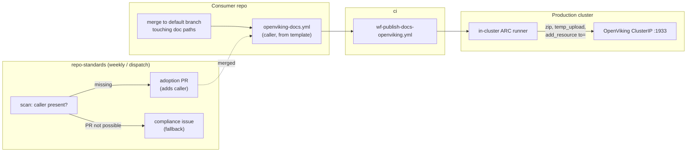

# OpenViking docs sync - plan (ARK-642)

Every Arkanis repo mirrors its docs into OpenViking (OV) on merge to the default branch, so any
agent in any repo can find another repo's knowledge by search. Git stays the source of truth; OV is
a read-only, cross-repo discovery mirror. The change lands in two repos plus one Infrastructure
prerequisite:

| Repo | Delivers |
|---|---|
| `ci` | `wf-publish-docs-openviking.yml` reusable workflow + canonical caller template |
| `repo-standards` | adoption check, scorecard column, automated adoption PRs (issue fallback) |
| `Infrastructure` | ARK-651 (done): OV reachable from `arkanis-runners` + non-admin OV `ci` user; ARK-652: runner provides the key |

> Diagram: how a merged doc change reaches OV, and how repo-standards drives adoption.

End-to-end flow

## Decisions already made

- **Reachability (ARK-642, 2026-10-25):** in-cluster runners call OV over ClusterIP. Not a
  Tailscale step on GitHub-hosted runners, which would need an ACL grant to
  `tag:production-k8s-ingress` and expose every internal admin UI to CI. Infrastructure side is
  ARK-651.
- **Runner pool (2026-10-25):** the existing `arkanis-runners` pool, no new scale set. Accepted
  costs: syncs share its `maxRunners: 2` with deploys, and run under the `arc-deployer` service
  account they do not need.
- **Credential (2026-10-25): runner-provided**, per the *Runner-Advertised Capabilities* pattern in
  `docs/runner-contract.md`. Org-level Actions secrets are unavailable to private repos on GitHub
  Free, so ARK-652 has the pool expose `OPENVIKING_API_KEY` (from 1Password via ESO) and
  `OPENVIKING_URL`. No GitHub secret, no per-repo setup. Accepted: every job on the pool can read
  the key, well below the deployer service account they already hold.
- **Repo-standards remediation is a pull request**, not only an issue: the fix is a deterministic
  templated file, which is exactly the bar the compliance catalog sets for `pull-request`.

## Defaults picked (override in review)

- **Standard paths:** `README.md`, `AGENTS.md`, `CLAUDE.md`, `docs/**/*.md`,
  `.claude/rules/**/*.md`, `.claude/context/**/*.md`, `openspec/specs/**/*.md`. Markdown only.
  Overridable per caller via an input.
- **Target layout:** `viking://resources/arkanis/projects/<repo>/`, mirroring repo paths, so a
  scope like `.../<repo>/.claude/rules` works as a directory-scoped search.
- **One import per run**, `to=` the repo root, tags `repo=<repo>`. Per-file `kind=` tags dropped:
  OV applies tags per request, not per file, so `kind` would mean one import per subtree with a
  non-mirrored layout. Path scoping covers the same need.
- **`processing_mode: vectors_only`.** Deterministic, no dependency on the Daedalus extraction LLM
  or its ~16k context limit. No VLM directory abstracts; revisit if browsing quality matters.
- **Empty doc set skips** the import (summary says so) rather than wiping the target.
- **Opt-out** for sensitive repos: a repo topic `openviking-docs-optout` makes the check N/A and
  suppresses the adoption PR. `viking://resources` is account-wide, so this is the visibility
  control. **Every automated adoption PR and compliance issue states the opt-out topic in its
  first lines**, before any other content: what it does, and the exact command to set it
  (`gh repo edit <org>/<repo> --add-topic openviking-docs-optout`).
- **Commit/PR types:** `feat(...)` for the ci workflow (it ships in the `v1` release consumers pin);
  `feat(...)` for the repo-standards check; adoption PRs are `ci: publish repo docs to OpenViking
  (repo-standards)` so they never cut a release in consumer repos.

## Tasks

### ci - `wf-publish-docs-openviking.yml`

1. **Workflow contract** (per `.github/workflows/AGENTS.md`): `on.workflow_call`, top-level
   `permissions: {}`, job `contents: read`. Inputs: `runs-on` (default `arkanis-runners`),
   `runs-on-json`, `runs-on-self-hosted` (default `true`), `include-paths` (newline globs, default
   the standard set), `openviking-url` (default
   the runner's `OPENVIKING_URL`, else `http://openviking.openviking.svc.cluster.local:1933`), `target-root` (default
   `viking://resources/arkanis/projects`), `processing-mode` (default `vectors_only`), `dry-run`
   (default `false`). No secret input: the key comes from the runner's `OPENVIKING_API_KEY`, read in
   a shell step; the job fails closed when it is absent (wrong pool), unless `dry-run`.
2. **Steps:** checkout caller (shallow) -> self-hosted preflight (record curl/zip/python3) ->
   collect matching tracked files via `git ls-files` -> fail closed above a size cap -> zip ->
   `dry-run` stops here with a file list -> `POST /api/v1/resources/temp_upload` ->
   `POST /api/v1/resources` with `to=<target-root>/<repo>`, tags, processing mode, `wait` with a
   bounded client timeout -> step summary, `run-metadata.json`, diagnostics with `if: always()`.
3. **Safety:** `concurrency: openviking-docs-<repo>` with `cancel-in-progress: true` (newest content
   wins). Repo name from `github.repository`, never caller text. Key only via env, never echoed.
4. **Dogfood in this repo:** a `dry-run` job in `release.yml` on PRs (no secret) proves collection
   and zipping. After ARK-652, a live run for `ci` itself on `main`.
5. **Caller template:** `templates/openviking-docs.yml` (canonical, consumed by repo-standards):
   `on: push` to the default branch with a `paths:` filter for the standard globs **plus the caller
   file itself**, so merging the adoption PR performs the first import; `workflow_dispatch` for
   backfill.
6. **Docs:** README *Public Workflows* row, `docs/workflow-catalog.md`, workflows `AGENTS.md` list,
   `docs/adr/0008-openviking-docs-sync.md` (reachability, identity, layout decisions).

### repo-standards - adoption

7. **Native check `repo-standards-openviking-docs`:** N/A when the repo has none of the standard
   doc paths or carries the opt-out topic; PASS when any workflow calls
   `ArkanisCorporation/ci/.github/workflows/wf-publish-docs-openviking.yml@`. Reuses `presentCi`.
   **Not** added to `expectedCi`, so the shared-CI issue does not double-report it.
8. **Scorecard:** `OV Docs` column in each *GitHub Actions CI* table, with the column guide line.
9. **Catalog entry** (`src/compliance.ts`): remediation `pull-request`; resolution, acceptance and
   references point at the ci template and ADR.
10. **Enforce path:** add the caller template where missing, PR body opening with the opt-out
    notice, on bot branch
    `repo-standards-bot/add-openviking-docs`, labels `automated` + `automated/repo-standards`, under
    the existing `maxPrsPerRun` cap and open-PR dedupe. Template is fetched from `ci` at a pinned
    ref so the two cannot drift.
11. **Issue fallback:** when the PR cannot be opened (push or permission rejected), reconcile a
    compliance issue for that repo instead of failing silently. The issue body opens with the same
    opt-out notice.
12. **Tests** alongside the existing ones (check states incl. opt-out, column render, catalog,
    enforce happy path + dedupe + fallback). **Docs:** README, AGENTS.md, `docs/github-app-setup.md`.

### Live verification (after ARK-652)

13. Run against `ci`: files appear under `viking://resources/arkanis/projects/ci/`, `find` returns
    them, tags present.
14. **Delete/rename pruning** (OV docs only say absent files "may be removed"): delete a doc, rerun,
    confirm it is gone. If not, add an explicit prune step (list target, delete extras) before
    rollout.
15. Dispatch enforce with a cap of 1-2 PRs, merge one, confirm the first import fires.

## Human steps (not agent-doable)

- **ARK-652** merged (ARK-651 already done: network peer + `ci` user + 1Password item).
- **repo-standards App permission:** add **Workflows: Read and write** and accept the pending
  permission request on the org installation. The App already has Contents write for the existing
  BOM/EditorConfig/gitattributes PRs, but GitHub rejects any App push that creates or changes a
  file under `.github/workflows/` unless the App also holds the separate `workflows` permission.
  Without it, step 10 cannot work and adoption falls back to issues only.
- **ci release:** merge -> semantic-release moves `v1` so consumers pick the workflow up.
- **Opt-out topics** on any repo whose docs must not be account-wide visible.

## Sequencing

1. This plan reviewed.
2. ci workflow + template + dry-run dogfood (no OV needed) -> PR.
3. repo-standards check + column + catalog + enforce path -> PR (scorecard shows the column
   immediately; PRs only when enforce is dispatched).
4. ARK-652 + human steps -> live verification (13-15) -> enforce rollout in capped batches.

## Out of scope / related

- Related to ARK-616 (auto-promote shared knowledge into `resources/`) and ARK-617
  (agent-conventions into OV): both write *curated* knowledge; this mirrors *repo* docs under a
  separate `projects/` subtree, so the trees do not collide.
- ARK-641 (Infrastructure single-source agent rules) is the first natural consumer.
